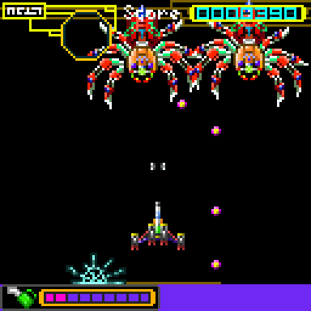
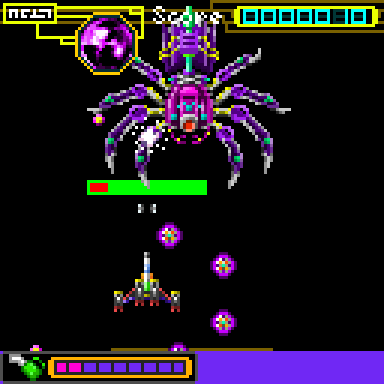
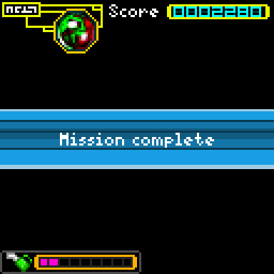
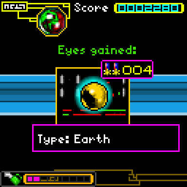

#  Phantom Spider RE

A native Windows, Linux and macOS port of **Phantom Spider**, a 2004 Nokia Series 40
J2ME shooter. You pilot the Phantom Spider against the Evil Tarantula's
army, collect the eyes of the spiders you defeat, and combine them into
stronger eyes that give your ship new weapons.

The original game was decompiled and every class rewritten in Rust ("RE" as
in reverse-engineered), so no Java runtime or emulator is involved. SDL3
handles the window, keyboard, gamepads, rumble and audio, and the shooting
game runs at a smooth 60 fps at the original pace.

| | | | |
| :-: | :-: | :-: | :-: |
|  |  |  |  |

## How to play

You need your own copy of the original game: **`Phantom_Spider_s40v2.jar`**,
the Nokia Series 40 128x128 release (118,744 bytes, SHA-256
`48a0b368429acae654520a4bcd40bbb17ff0f9833d665d9278a6d50d5fc5520d`). It isn't
included here or in the releases.

1. Download your system's build from
   [Releases](https://github.com/Xarishark/phantom-spider-re/releases)
   (`PhantomSpiderRE-v…-Windows-x64.zip`, `-Linux-x64.tar.gz` or
   `-macOS-arm64.zip`) and unpack it somewhere you can write to (not
   Program Files).
2. Run `PhantomSpider.exe` (`phantom-spider` on Linux and macOS; the Mac
   build isn't signed, so the first time right-click it and choose Open).
   On the first start it asks for the JAR: drop it on the window, or press
   Enter to pick it. (A JAR placed next to the program, or `--game <path>`,
   works too.)
3. The game checks the file and unpacks its art, music and text into
   `data/`. From then on it starts straight into the game.

The release includes a General MIDI SoundFont
([GeneralUser GS](https://github.com/mrbumpy409/GeneralUser-GS)) for the
music. Any `.sf2` next to the program works; without one the game is silent.

### RecompLauncher

Phantom Spider RE supports [RecompLauncher](https://recomplauncher.com)
fully (`recomplauncher.json`, levels 1 to 3): the launcher installs and
updates it from this repo's releases, asks for your JAR on its setup screen
and unpacks it with the game's own setup step, shows the settings on the
game's page, backs up your saves, and attaches the log to crash reports.
Big Picture mode starts the game full screen.

## Controls

The game starts in full screen by default. Press F, F11 or Alt+Enter to switch to a window.

| Action | Keyboard | Gamepad |
| --- | --- | --- |
| Move / navigate | Arrows, WASD, keypad 2/4/6/8 | D-pad, left stick, LB/RB |
| Fire / select (hold to charge eye weapons) | Enter, Space, keypad 5 | A, X, right trigger |
| Menu / pause / back | Esc | B, Start |
| Left soft key | Tab, F1 | Y, Back, left trigger |
| Clear a digit in forms | Backspace | |
| Phone keypad digits | 0-9 | |
| Full screen | F, F11, Alt+Enter | |
| Mute / volume | M, +/- | |

You can connect or disconnect gamepads on the JAR setup screen or during play. All connected gamepads control the same player.

## Files and settings

Everything stays in the game's folder, so the whole folder is portable:

| | |
| --- | --- |
| `save/` | your progress and high scores (`Phoenix7.rms`, the original format) |
| `data/` | the art, music and text unpacked from your JAR |
| `settings.toml` | window size, full screen, scaling, music, rumble, language (commented) |
| `logs/` | `phantom-spider.log` from the last three runs |

If the folder can't be written, the game shows an error and stops instead of
saving somewhere else.

Command line options (they override `settings.toml`): `--game <jar>`,
`--scale N`, `--fullscreen`, `--soundfont file.sf2`, `--mute`,
`--no-rumble`, `--lang xx|tl-PH`. `--help` lists everything.

## Differences from the phone version

- **60 fps.** The phone updated the game every 150 ms. Movement now runs at
  60 Hz while everything the original counted in frames (AI, cooldowns,
  charge, damage) keeps its original timing, so the game plays at the same
  pace. Details in [docs/PORTING.md](docs/PORTING.md).
- **No SMS challenges.** "Challenge player" sent SMS messages between phones;
  it now only shows a notice.
- **Score is kept between sessions.** The original reset it on every launch
  unless a mission was paused. Only "New game" resets it now.
- **Controls:** releasing one direction while another is held keeps you
  moving (the phone only had one direction at a time). Taking damage rumbles
  the gamepad.

Everything else (missions, eye collecting, combining and equipping, pilot
and spider stats, high scores, the animated instructions, pause/continue,
the original cheat codes) works as on the phone.

## Building

A recent stable Rust toolchain and CMake. SDL3 is built from source and
linked statically, so the program needs nothing else installed. Building
doesn't need the game; running it does. On Linux, install the X11, Wayland
and audio development headers SDL uses (the list is in
`.github/workflows/build.yml`), then:

```bash
cargo build --release
```

Release archives come from `tools/package-release.sh windows|linux|macos`
(`SOUNDFONT=file.sf2` adds a SoundFont). The Windows `.exe` is
cross-compiled from Linux with MinGW (`mingw64-gcc`):

```bash
rustup target add x86_64-pc-windows-gnu
tools/package-release.sh windows   # dist/PhantomSpiderRE-v<version>-Windows-x64.zip
```

CI builds all three on every push and pull request.

`tools/run-tests.sh` plays through the game headless with the scripts in
`tests/scripts/` and saves screenshots; it needs your JAR in `game-files/`
(git-ignored) or `PHANTOM_SPIDER_JAR`. See [docs/PORTING.md](docs/PORTING.md)
for how the port is organized.

## Credits and copyright

Phantom Spider (2004) lists its vendor as **ANDREW-LVIV / Nokia**. All rights
to the original game, its name, artwork, music and text belong to their
respective owners. The icon above comes from the original JAR. The
screenshots show the port running. Players supply their own JAR.

This project is not affiliated with or endorsed by Nokia or ANDREW-LVIV.
The port's source code is released under the [MIT License](LICENSE).
